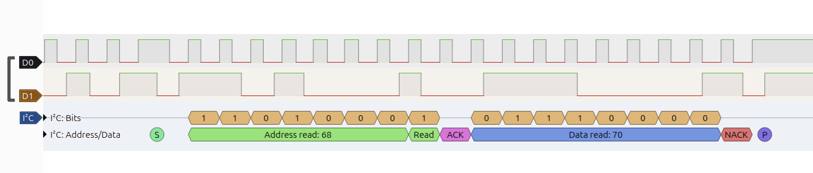

# pi-tracker

Embedded Linux project on a Raspberry Pi 5 in modern C++ (C++20): userspace sensor drivers,
a multithreaded sensor daemon with UDP telemetry and, next, camera video streaming and MAVLink guidance.

## Hardware

| Part | Notes |
|---|---|
| Raspberry Pi 5 | Debian 13 (trixie), kernel 6.18 |
| GY-521 IMU board | sold as MPU-6050, but `WHO_AM_I = 0x70` shows it is an **MPU-6500** (I2C `0x68`) |
| GY-302 (BH1750) | ambient light sensor (I2C `0x23`) |
| Benewake TF-Luna | ToF lidar, 0.2–8 m, UART 115200 8N1, 100 frames/s |
| Logic analyzer | 24 MHz, 8 channels (FX2-based, works with sigrok via `fx2lafw`) |

## Project layout

```
include/pi_tracker/   public headers of the pitracker library
  fd.h                  RAII owner of a Linux file descriptor (move-only)
  ring_buffer.h         fixed-capacity ring buffer, no heap allocation
  thread_safe_queue.h   blocking queue (mutex + condition_variable): popFor timeout, optional capacity
  i2c_device.h          register-level I2C access via I2C_RDWR (repeated START)
  imu.h                 MPU-6500 driver: init, ranges, DLPF, gyro calibration
  serial_port.h         UART in raw mode (termios), read with 100 ms timeout
  tf_luna.h             byte-stream parser for TF-Luna frames (sync + checksum)
  udp_sender.h          UDP datagram sender (IPv4)
src/                  library sources
apps/sensord.cpp      sensor daemon: IMU + lidar threads → queue → UDP
deploy/               systemd unit and its configuration file
sandbox/              daily exercises (dayNN_*.cpp), each built as its own executable
data/                 recorded sensor logs and logic analyzer captures
docs/buses.md         notes on UART / I2C / SPI
```

## Build

```bash
cmake -S . -B build
cmake --build build
```

`sudo cmake --install build` installs `sensord` to `/usr/local/bin` (see [sensord](#sensord)).

## IMU driver (MPU-6500)

- Initialisation follows the register map: reset, PLL clock, `WHO_AM_I` check,
  ±4 g / ±500 °/s ranges, on-chip low-pass filters (gyro ≈41 Hz, accel ≈45 Hz) against
  motor-vibration aliasing, 100 Hz sample rate.
- One 14-byte burst read per sample (accel, temperature, gyro) gives a consistent snapshot.
- Gyro bias is calibrated at startup by averaging 200 samples at rest.

`sandbox/day10_imu_logger.cpp` logs 10 s at 100 Hz (`sleep_until` scheduling) to CSV:

| Metric | Result |
|---|---|
| Samples / gaps | 1000 / 0 |
| I2C read time | ≈1.6 ms per sample (bus at 100 kHz) |
| Gyro at rest, max \|ω\| | ≈5 °/s before calibration → 0.15 °/s after |
| Integrated yaw drift over 10 s | −0.02° |

## Logic analyzer: I2C on the wire

Captured on the Pi with `sigrok-cli`, viewed in PulseView. Reading the `WHO_AM_I`
register of the IMU:



- `Address read: 68` — the address byte on the wire is `0xD1` (`0x68 << 1 | R`);
- `ACK` from the sensor, then `Data read: 70` — the MPU-6500 chip ID;
- `NACK` from the Pi (master: "no more bytes"), then `STOP`.

What the capture confirmed:

- **Bus time dominates the read.** A 14-byte register read is 153 SCL clocks
  (3 address/register bytes + 14 data bytes, 9 clocks each) ≈ 1.53 ms at 100 kHz, which
  matches the ≈1.6 ms measured in the logger. Raising the bus to 400 kHz should make it ~4× faster.
- **Trigger pitfall.** Triggering on the first falling edge of SDA without pre-trigger samples
  cut off the initial START, so the decoder skipped the register-address write and labelled
  the repeated START as a plain `S`. Capturing with a wider window (or pre-trigger) shows the
  full write → repeated START → read sequence.

Raw captures: `data/day11_whoami.sr`, `data/day11_logger.sr` (open in PulseView).

## Lidar (TF-Luna)

### Wiring

UART0 is enabled with `dtparam=uart0=on` in `/boot/firmware/config.txt` and appears as
`/dev/ttyAMA0` (`ttyAMA10` is the Pi 5 debug console). Signal lines are 3.3 V, so the
lidar connects directly; only its power pin takes 5 V. Wire with the Pi powered off.

| TF-Luna pin | Function | Raspberry Pi 5 header |
|---|---|---|
| 1 | +5V | pin 2 or 4 (5 V) |
| 2 | RXD/SDA | pin 8 — GPIO14, TXD0 (TX ↔ RX are crossed) |
| 3 | TXD/SCL | pin 10 — GPIO15, RXD0 |
| 4 | GND | pin 6 (GND) |
| 5 | Configuration input | not connected → UART mode (tied to GND it selects I2C mode) |
| 6 | Multiplexing output | not connected |

### Frame format

The lidar streams 9-byte frames at 100 Hz:

| Byte | 0 | 1 | 2 | 3 | 4 | 5 | 6 | 7 | 8 |
|---|---|---|---|---|---|---|---|---|---|
| Content | `0x59` | `0x59` | Dist_L | Dist_H | Amp_L | Amp_H | Temp_L | Temp_H | Checksum |

- **Header** `0x59 0x59` marks the start of a frame.
- **Distance** in cm, **little-endian** (low byte first) — the opposite of the big-endian
  MPU-6500 registers.
- **Amplitude** is the signal strength; below 100 or equal to 65535 (overexposure) the
  distance is unreliable.
- **Temperature** of the chip: `°C = raw / 8 − 256`.
- **Checksum** is the low byte of the sum of bytes 0–7.

At 115200 baud one bit lasts 8.68 µs, and a 9-byte frame (10 bits per byte with start and
stop bits) takes ≈0.78 ms on the wire.

### Implementation

- **`SerialPort`** opens the port in raw mode (`cfmakeraw`): no line buffering, no echo, no
  CR/LF translation and no control characters, which would corrupt a binary protocol.
  115200 8N1, no flow control. `VMIN = 0`, `VTIME = 1`: `read()` returns whatever arrived
  within 100 ms, possibly 0 bytes, so a silent sensor is detected instead of blocking forever.
- **`TfLunaParser::feed(byte)`** is a state machine. UART is a byte stream without
  boundaries: a `read()` may return half a frame or start in the middle of one. The parser hunts
  for `0x59 0x59`, collects 9 bytes, verifies the checksum and re-synchronises on a mismatch.
  Frames are decoded byte by byte with shifts, not by casting the buffer to a struct
  (padding and endianness would break that).
- **`sandbox/day12_parser_test.cpp`** checks the parser without hardware: leading garbage, a
  valid frame, a frame with a broken checksum and another valid frame give
  `frames: 2, checksum errors: 1`.

## sensord

A daemon that reads both sensors in their own threads and streams the data as UDP telemetry.

```
 ┌──────────────┐ push ┌───────────────────┐ popFor(100 ms) ┌──────────────────────┐  UDP  ┌────────────┐
 │ sd-imu       │─────►│                   │───────────────►│ main thread          │──────►│ ground PC  │
 │ 100 Hz, I2C  │      │  ThreadSafeQueue  │                │ std::visit → CSV line│       │ port 5005  │
 ├──────────────┤ push │  <SensorMessage>  │                │ watchdogs, stats     │       └────────────┘
 │ sd-lidar     │─────►│                   │                └──────────┬───────────┘
 │ 100 Hz, UART │      └───────────────────┘                           │ stderr
 └──────────────┘                                                      ▼
                                                                    journald
```

### Design

- **One owner per object.** `Imu` is used only by `sd-imu`, `SerialPort` only by `sd-lidar`,
  `UdpSender` only by the main thread. The queue is the only shared object, so the drivers need
  no locks.
- **Typed messages.** The queue holds `std::variant<ImuReading, LidarReading, SensorError>`;
  the main thread handles it with `std::visit` and an `Overloaded` set of lambdas, and a missing
  case is a compile error.
- **Errors cross threads as data.** An exception cannot leave a thread (it would call
  `std::terminate`), so each sensor thread catches it and pushes a `SensorError` message.
- **Fail fast at startup.** The UDP address is validated before touching the hardware. A fatal
  error (bad address, sensor not found) propagates out of `run()`, `main` logs it and returns
  exit code 1, so systemd restarts the service and the log shows a clear message.
- **Watchdogs.** Each sensor has a watchdog (IMU 100 ms, lidar 500 ms) driven by the data
  timestamps. It logs only state changes (`[watchdog] lidar: LOST` / `restored`), and it also
  fires when the consumer falls behind and the data in the queue gets stale.
- **Graceful shutdown.** `SIGINT`/`SIGTERM` set a lock-free `std::atomic<bool>`; the main loop
  wakes at least every 100 ms (`popFor`) and exits. The threads are declared last, so they are
  destroyed first: `std::jthread` requests stop and joins. Joining is bounded because the UART
  read times out after 100 ms. RAII then closes the serial port and the I2C device.
- **Diagnostics go to stderr**, which is unbuffered, so lines reach the journal immediately.
  Telemetry goes over UDP.

### Telemetry format

One UDP datagram per reading, a CSV line; `t_ms` is milliseconds since sensord started
(`steady_clock`):

```
imu,<t_ms>,<ax>,<ay>,<az>,<gx>,<gy>,<gz>      accel in m/s², gyro in °/s
lidar,<t_ms>,<distance_cm>,<amplitude>
```

```
imu,4461,-0.405,-0.005,-9.471,-0.06,-0.02,0.01
lidar,4470,130,1760
```

Once per second sensord logs its statistics; a typical run on the Pi:

```
imu 100/s, lidar 100/s, send errors 0, queue max 0
```

### Running

Manually (stop the service first, or two processes will fight over the sensors):

```bash
./build/sensord 192.168.0.172 5005     # host and port of the receiver; default 127.0.0.1:5005
```

As a systemd service — starts at boot and restarts after a crash:

```bash
sudo cmake --install build
sudo install -m 644 deploy/sensord.service /etc/systemd/system/sensord.service
sudo install -m 644 deploy/sensord.default /etc/default/sensord   # set SENSORD_HOST / SENSORD_PORT
sudo systemctl daemon-reload
sudo systemctl enable --now sensord
journalctl -u sensord -f
```

After a code change: `cmake --build build && sudo cmake --install build && sudo systemctl restart sensord`.
Raspberry Pi OS keeps the journal in RAM by default, so logs do not survive a reboot.

### Receiving

```bash
python3 -u -c '
import socket
s = socket.socket(socket.AF_INET, socket.SOCK_DGRAM)
s.bind(("0.0.0.0", 5005))
while True:
    print(s.recv(2048).decode(), end="")
'
```

`nc -u -l 5005` also works, but only until sensord restarts: netcat locks onto the first
sender's address and port, and a restarted sensord sends from a new source port.
